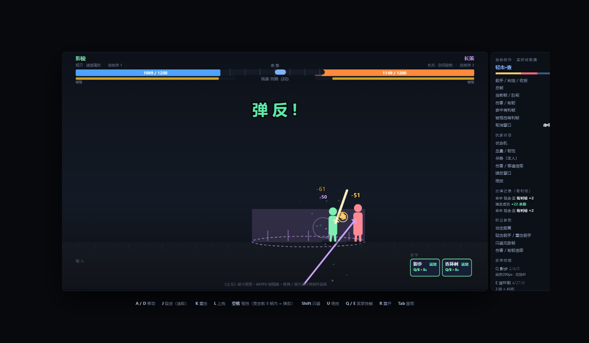

# 《止戈》战斗设计作品集 · Zhige Combat Design Portfolio

> **黄渊** · 2027 届 · 求职意向：**游戏战斗策划**（网易雷火「虚拟世界架构师」方向）
>
> 一款原创 3v3 冷兵器竞技游戏的**完整战斗系统设计** —— 文档 + 可玩原型 + 数值仿真，三者共用同一套数值并用脚本自动核验一致。

---

## ▶ 直接开打

### **[点这里在线试玩 →](https://yuan8863.github.io/zhige-combat-design/)**

浏览器打开即玩，无需安装。**手机横屏也支持**（屏幕下方会自动出现触摸按键）。

**操作**

| 键 | 动作 | 键 | 动作 |
|---|---|---|---|
| `A` `D` | 左右移动 | `空格`(按住) | 格挡（受击前 8 帧内按下 = **弹反**） |
| `J` | 轻击（可连段 A1→A2→A3） | `Shift` | 闪避（8~10 帧无敌） |
| `K` | 重击（慢，但能打破格挡） | `U` | 绝技（需杀势 ≥ 60） |
| `L` | 上挑 | `Q` `E` | **武学技能**（每职业 2 个，带冷却） |
| `R` | 重开 | `Tab` | 收起/展开右侧帧数据面板 |

> **想打出弹反**：不要一看到对手抬手就架格挡，要压到**判定前 5 帧**再按——8 帧窗口很窄，架早了就变成普通格挡。

### 玩的时候看右侧面板

它会**实时显示你当前招式的起手 / 判定 / 收招帧数，以及命中与被格挡的有利帧**。你可以一边打，一边对照 [`docs/01-combat-white-paper.md`](docs/01-combat-white-paper.md) §3.2 的帧数据表逐项核对。

**大多数候选人的帧数据活在 Word 里，这份活在浏览器里——而且可以被当场推翻。**



---

## 这份作品集和别的有什么不同

战斗策划岗的作品集，绝大多数是一份设计文档。但文档**无法被证伪**——写得再漂亮，面试官也没法知道那套帧数据跑起来是不是那个手感、那套数值是不是真的平衡、作者是不是根本不知道自己在哪一步想错了。

所以我交的是三件**互相咬合**的产物：

| 回答什么问题 | 工具 | 在哪 |
|---|---|---|
| "你的帧数据跑起来是这个手感吗？" | **可玩原型**（单文件 HTML，60FPS 帧精确） | [`index.html`](index.html) |
| "你说平衡就平衡？" | **帧级蒙特卡洛仿真**（累计 20 万局） | [`sim/`](sim/) |
| "你知道自己哪里错了吗？" | **设计复盘 + 调参记录** | [`docs/03-simulation-report.md`](docs/03-simulation-report.md) |

三者的数字**逐字段一致**，用脚本自动核验：**原型 216 项 + 仿真 240 项，全部通过**。

---

## 仿真实测结果

| 指标 | 设计目标 | 实测 | |
|---|---|---|---|
| 四职业平均胜率 | 48%~52% | **48.6% / 49.8% / 49.1% / 49.6%**（极差 1.2pp） | ✅ |
| 反制矩阵（12 个对位） | 42%~58% | **12/12 全部落入**（44.3%~56.1%） | ✅ |
| 中水平 1v1 TTK | 16~22 秒 | **19.3 秒**（新手 12.1 / 高手 24.2） | ✅ |
| 技术 +10% 能否覆盖克制优势 | 能 | 53.9% → **46.1%** | ✅ |
| 墙面惩罚（贴墙是否构成劣势） | 击退被吸收 | **贴墙平均代价 4.3pp** | ✅ |
| 落后 60 杀势时劣势方胜率 | 35%~42% | 43.7%（单点未达标） | ⚠️ |

> ⚠️ **最后一项我没达标，也没删改。** 但完整的杀势价值曲线是达标的：均势 52.6% → 压制 48.2% → 掌控 44.2% → 碾压 40.2%，**每档约值 4 个百分点**。我把评估口径改成了「曲线单调性 + 每档梯度 + 全区间幅度」并说明了理由 —— 详见 [仿真报告 §6.3](docs/03-simulation-report.md)。

---

## 仿真推翻了我三次

这一节是我最想让人看到的。完整的 12 轮调参记录（**含两处失败**）在[仿真报告](docs/03-simulation-report.md)里。

**① 影梭的 3 帧起手 —— 实测 93.7% 胜率**

我给快攻职业设计了 3 帧起手（50ms），并用 28% 的伤害惩罚去平衡它。仿真跑出来**碾压全场**。

原因很讽刺：3 帧 = 50ms，而人类简单视觉反应时约 200ms——**它在物理上不可能被反应**。它不叫"快"，叫"**无法防御**"。

而我自己在白皮书 §2.2 里白纸黑字写着：**"相克关系必须是可被观察的，否则博弈退化为运气。"**

**我违反了自己定的原则，是数据把我抓出来的。** 改成 5 帧后回落到 43.8%。

**② 「困兽之斗」整个机制是失效的**

我用 A/B 对照测这个"反滚雪球机制"到底有没有用——**只挽回了 1.0 个百分点**。

去数事件频次才发现根因：这套补偿全挂在**弹反**上，而**弹反每局只发生 1.5 次**。

> **一个建立在低频事件上的补偿机制，效果上限由事件频次决定，而不是由补偿强度决定。**

把补偿改成**每帧都在生效的连续型防守能力**后，贡献提升到 1.9pp。

**③ 横驱的 AOE 永远打不中**

"后跳 220px + 落地 180px 范围冲击"——**后跳距离大于冲击半径**，落地时对手必然在范围外。

**这条光看文档发现不了**，是把技能实装进原型写测试时打出 `敌人掉血 0` 才暴露的。

---

## 还有五个"能玩但错了"的 bug

仿真顺手抓出来的，都是策划写文档不会发现、做 Demo 摆拍也不会发现的类型：

| Bug | 后果 |
|---|---|
| **霸体只画了圈，从未参与判定** | 重锋的核心机制完全失效——**有视觉反馈，无功能实现** |
| **命中结算按固定顺序执行** | 同帧交换时先结算方白赢，矩阵 A/B 视角胜率之和达 **111.6%** |
| **顿帧期间玩家输入被整个丢弃** | 50~200ms 内按的键全部无效，经典的"**我明明按了但没反应**" |
| **AI 把"靠近"算成了反方向** | AI 跑到墙角不动 |
| **输入键名不匹配**（`skill1` vs `s1`） | Q/E 技能按钮亮着但放不出来 |

---

## 仓库结构

```
.
├── index.html                      # 可玩原型（GitHub Pages 入口）
├── docs/                           # 7 份设计文档
│   ├── 00-overview.md              #   总览 + 达标/未达标清单（建议先看）
│   ├── 01-combat-white-paper.md    #   完整战斗系统设计（帧数据 / 有利帧 / 韧性 / 杀势）
│   ├── 02-hero-skills.md           #   4 职业帧表 · 8 个武学技能 · 反制矩阵
│   ├── 03-simulation-report.md     #   20 万局仿真 + 12 轮调参记录
│   ├── 04-moba-teardown.md         #   基于 1500+ 小时体验的 MOBA 对抗结构拆解
│   ├── 05-hit-feel-spec.md         #   写给程序/美术/音频的帧级表现规范
│   └── 06-cover-letter.md          #   对照岗位要求的求职陈述
├── prototype/
│   ├── zhige-prototype.html        # 同 index.html（本地双击也能玩）
│   ├── verify-consistency.js       # 三方一致性核验（粘贴到浏览器控制台运行）
│   └── screenshots/
├── sim/                            # 纯 Python 标准库，无第三方依赖
│   ├── combat_balance_sim.py       #   帧级蒙特卡洛平衡仿真
│   ├── verify.py                   #   三方一致性核验（240 字段）
│   └── wall_penalty.py             #   墙面惩罚专项 A/B 验证
└── resume/
    └── Yuan-Huang-Combat-Designer-Resume.pdf
```

---

## 自己跑一遍

**① 核验数据是不是真的**（各 1 秒）

```bash
cd sim
python verify.py                        # 核验 240 个字段
python combat_balance_sim.py --quick    # 约 12 秒跑一轮平衡仿真
```

**② 原型端核验**

打开 `index.html` → `F12` → 控制台 → 粘贴 [`prototype/verify-consistency.js`](prototype/verify-consistency.js) 的内容 → 回车。会核验 216 个字段。

**③ 完整规模仿真**（每格 1500 局，约 7 分钟）

```bash
python combat_balance_sim.py --n 1500 --seed 20260930
```

环境要求：**Python 3.8+，仅用标准库**（`random` / `json` / `argparse` / `time`）。固定随机种子，结果可完全复现。

---

## 设计要点速览

**核心机制：共享「杀势」条**

一条 −100 ~ +100 的**双方共享**资源条。攻击命中、弹反成功都会推动它；它**可见、可被抢夺**。阈值 30/60/90 分四档，难度越高优势方增益越强，到 60 解锁绝技。

> 我用它解决"优势无法感知"与"优势被固化"两个矛盾——**把优势做成一条可以被抢走的资源，而不是一个锁死的胜局。**

**职业身份来自绝对速度和攻击距离，不是数值高低**

推导有利帧时发现：`有利帧 = 受击僵直 −（总帧 − 起手）`，而**起手每减少 1 帧、总帧也减少 1 帧，两项互相抵消**——四个职业的有利帧完全相同。

所以真正区分职业的是：**判定生效的绝对帧数**（决定抢帧）、**攻击距离**（决定谁先进入判定区）、**削韧效率**、**机制特权**。

**四个职业**

| 职业 | 一句话 | 起手 | 距离 | 特权 |
|---|---|---|---|---|
| 执锐 | 基准的均衡者 | 6f | 140px | 连段最完整 |
| 影梭 | 用伤害换速度的骚扰者 | **5f** | 115px | 闪避无敌 10f |
| 长策 | 用近身换距离的控制者 | 8f | **225px** | 击退 ×1.7 + 枪阵 |
| 重锋 | 用霸体换速度的压制者 | 10f | 175px | 第 8f 起霸体 |

---

## 已知的局限

我把这些写在明面上，因为它们比"全部达标"更能说明这份工作是怎么做的：

- **没有真人测试** —— 所有"玩家"都是我写的 AI 策略模型。绝对胜率不可直接采信，只能用于相对比较。
- **只有 1v1** —— 3v3 团队层（集火 / 援护 / 换人）只有设计草案，未实现。
- **地图几何极简** —— 只有左右两道墙（墙面惩罚已单独验证），没有掩体、高低差。
- **技能的战术规划粗糙** —— AI 按情境概率放技能，没有"留大招等斩杀"的规划。

---

## 关于我

**黄渊** · 华北电力大学（211 / 双一流）· 金融专业 · 本科 · 2027.06 毕业

累计游戏时长 **10000+ 小时**：《王者荣耀》开服玩家 1500h+（荣耀王者 50 星+，巅峰赛最高 1900 分）·《和平精英》开服玩家 1000h+（超级王牌 23 星）·《三角洲行动》烽火地带「天才少年」·《金铲铲之战》500h+（傲世宗师）

金融科班的数据分析训练 + Python 实操，让我能**自己验证自己的设计**——这也是这份作品集存在的理由。

📧 18789808863@163.com

---

*本仓库全部内容为原创设计。欢迎对帧、跑仿真、提 issue。*
